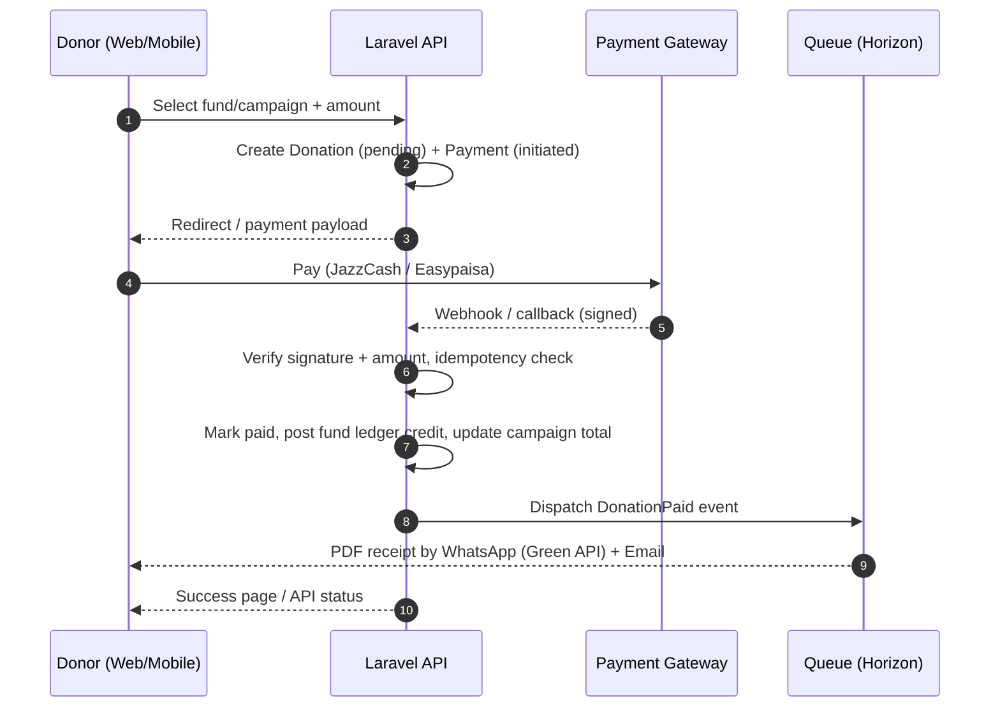
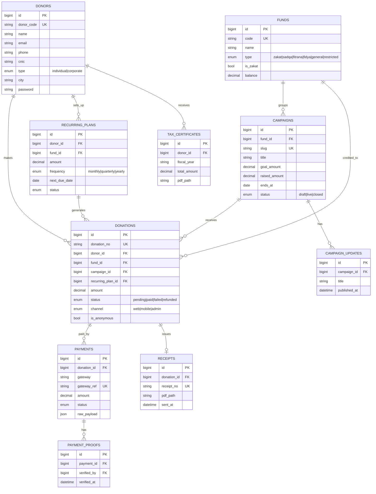
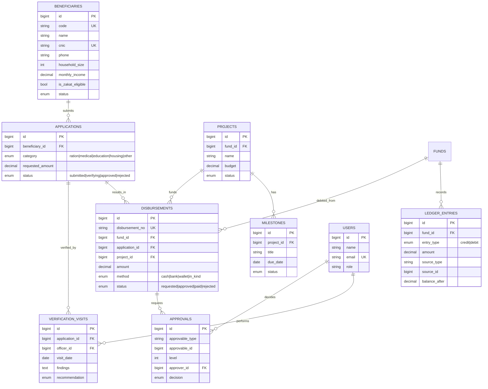
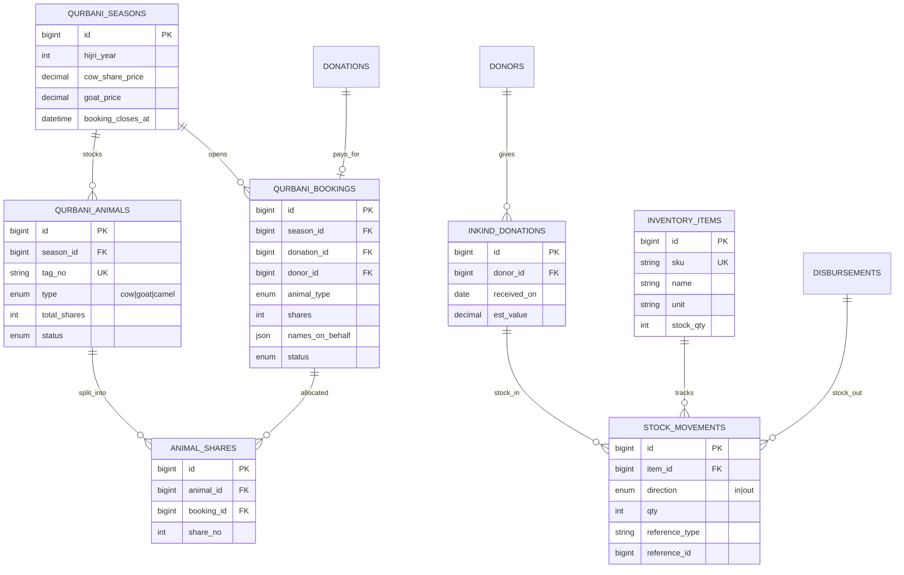

# Donation Management System — SRS / BRD (v1.2)

> Source of truth for requirements. Mirrors the signed Word document.
> When a requirement changes, update this file in the same commit as the code.
> Requirement IDs (BR-xx, FR-xxx-xx, NFR-xx) are referenced in code comments, tests and commit messages.

**Scope:** single NGO · Laravel 13 · Filament 5 (admin) · Blade + Alpine.js + Livewire (public) · REST API /api/v1 for a separate mobile app.

## 1. Glossary
| Term | Meaning |
| --- | --- |
| Zakat | Obligatory annual alms; must be kept in a separate fund and spent only on eligible recipients. |
| Sadqa / Atiya | Voluntary charity; can be used for general welfare and operating needs. |
| Fitrana | Charity paid per person before Eid-ul-Fitr; seasonal collection. |
| Fidya | Compensation for missed fasts; restricted to feeding the needy. |
| Fund | A ledger bucket that holds money by type (Zakat, Sadqa, Restricted, etc.). |
| Campaign | A time-bound or open appeal (e.g., Winter Relief) that collects money into one fund. |
| Disbursement | Money or goods paid out of a fund to a beneficiary or project. |
| Raast / IBFT | State Bank of Pakistan instant payment system / inter-bank funds transfer. |
| CNIC / NTN | Computerised National Identity Card / National Tax Number. |
| PSP | Payment Service Provider (card processing) — Phase 2. |
| Green API | Third-party WhatsApp gateway (green-api.com) used to send WhatsApp messages and PDF receipts over HTTP. |
| Filament | Laravel admin-panel framework used for all staff panels. |
| Sanctum | Laravel token authentication used by the mobile API. |

## 2. Business requirements
### 2.1 Objectives
| ID | Objective |
| --- | --- |
| OBJ-1 | Accept donations online (web + mobile) through local payment channels with instant confirmation and receipts. |
| OBJ-2 | Keep Zakat, Sadqa, Fitrana and restricted money strictly separated with a fund-wise ledger. |
| OBJ-3 | Give donors self-service: history, receipts, annual tax certificates and recurring pledges. |
| OBJ-4 | Run the full program cycle: beneficiary intake, verification, approval and disbursement. |
| OBJ-5 | Give management and auditors real-time, trustworthy reporting with a complete audit trail. |
| OBJ-6 | Handle seasonal peaks (Ramadan, Qurbani) without manual spreadsheets. |

### 2.2 Stakeholders
| Stakeholder | Role | Responsibility |
| --- | --- | --- |
| Founder / NGO Management (Nadeem Ahmad) | Owner, sponsor & approver | Vision, scope sign-off, campaign strategy, policies |
| Board of Trustees (as constituted) | Governance | High-value disbursement approval, annual accounts |
| Finance Team | Primary user | Payment verification, reconciliation, ledger, receipts |
| Program / Field Officers | Primary user | Beneficiary intake, verification visits, disbursement requests |
| Campaign / Content Team | Primary user | Campaigns, updates, website content |
| Donors (individual & corporate) | External user | Donate, manage pledges, download receipts |
| External Auditor | Read-only user | Reviews ledgers, approvals and audit trail |
| Technical Lead (Nadeem Ahmad) | Builder | Architecture, development with Claude Code, deployment, maintenance |

### 2.3 In scope
- Public donation website (Blade + Alpine.js + Livewire), donor portal and Zakat calculator
- Filament 5 admin panel for all staff roles
- Versioned REST API (/api/v1) for the mobile app, with API documentation
- Payment integration: JazzCash, Easypaisa, bank/Raast transfer with proof upload, cash/cheque entry (card payments in Phase 2; gateway interface ready)
- Funds, campaigns, donations, receipts, tax certificates, recurring pledges
- Beneficiaries, verification, approvals, disbursements, projects and impact updates
- Qurbani booking and in-kind donation inventory
- Fund ledger, gateway reconciliation, dashboards, reports, audit trail

### 2.4 Out of scope
- Mobile app UI/UX and build (separate project; only the APIs are delivered here)
- Multi-tenancy (system serves one NGO)
- Full double-entry accounting / payroll (export to the NGO's accounting software instead)
- Card payments via a PSP, peer-to-peer fundraising, CSR matching, volunteer management (Phase 2 roadmap)
- Payment-gateway merchant onboarding paperwork (NGO responsibility)

### 2.5 Business rules (enforced in services + tested)
| ID | Rule |
| --- | --- |
| BR-01 | Every donation belongs to exactly one fund. A campaign always maps to one fund. |
| BR-02 | Zakat money can only be disbursed to beneficiaries flagged Zakat-eligible. The system blocks any other use. |
| BR-03 | A donation is credited to the fund ledger only after payment is confirmed: a verified gateway webhook, or manual proof approved by Finance. |
| BR-04 | Donation, receipt and disbursement numbers are sequential, unique and never reused (e.g., DN-2026-000123). |
| BR-05 | Paid donations cannot be edited or deleted. Corrections happen only through refund / reversal entries. |
| BR-06 | Disbursements need an approval from someone other than the requester. Exception while the NGO has one approver: when the 'Allow founder self-approval' setting is on (default on at launch), a Super Admin may approve their own request; each such approval is flagged 'self-approved' and audit-logged. Turning the setting off enforces two-person approval for all new requests. |
| BR-07 | A fund balance can never go negative. Disbursement approval checks available balance at approval time. |
| BR-08 | Anonymous donors are hidden on all public surfaces but retained internally for receipts and audit. |
| BR-09 | A campaign closes automatically at its end date. Later donations go to the campaign's parent fund. |
| BR-10 | Restricted-fund money is used only for the restriction recorded on the fund. |
| BR-11 | Qurbani bookings close at the season cut-off. Shares per animal follow the configured count (cow = 7). |
| BR-12 | Tax certificates are issued only to donors with a CNIC or NTN on file. |

### 2.6 Assumptions
- Merchant accounts with JazzCash and Easypaisa are applied for in Week 1; sandbox credentials are available by Week 4. A card PSP is applied for later (Phase 2).
- Sandbox credentials for each gateway are available at the start of Week 4.
- A Green API instance (WhatsApp) is already available. An SMS provider is optional and only used as a fallback for OTP.
- The founder (Nadeem Ahmad) owns the requirements and builds the system with Claude Code; UAT is done with the NGO's first staff/volunteers.
- Hosting is a Linux VPS or managed Laravel host with MySQL 8, Redis and S3-compatible storage.
- Interface language is English at launch; the public site is built translation-ready for Urdu (RTL).

## 3. Software requirements
### 3.1 Roles & permissions
F = full · C = create/edit · A = approve · V = view · - = none. Donors use a separate guard and see only their own data.

| Area | Super Admin | Manager | Finance | Campaign Mgr | Field Officer | Trustee | Auditor |
| --- | --- | --- | --- | --- | --- | --- | --- |
| Users, roles & settings | F | V | - | - | - | - | V |
| Donors | F | C | C | V | - | V | V |
| Funds & campaigns | F | C | V | C | - | V | V |
| Donations & payments | F | V | C | V | - | V | V |
| Proof verification | F | - | A | - | - | - | V |
| Receipts & certificates | F | V | C | - | - | - | V |
| Beneficiaries & applications | F | C | V | - | C | V | V |
| Disbursements | F | A | C | - | C | A | V |
| Qurbani & inventory | F | C | C | C | C | V | V |
| Ledger & reconciliation | F | V | C | - | - | V | V |
| Reports & dashboard | F | V | V | V | V | V | V |
| CMS content | F | C | - | C | - | - | - |
| Audit log | V | V | - | - | - | V | V |

### 3.2 Functional requirements
Priority: Must (go-live) · Should (go-live if time allows) · Could (Phase 2).

#### M01 Access Control & Settings
| ID | Requirement | Priority |
| --- | --- | --- |
| FR-ACC-01 | Staff log in to /admin with email + password; 2FA (TOTP) is mandatory for Super Admin, Finance and Trustee roles. | Must |
| FR-ACC-02 | Super Admin manages users, roles and granular permissions per Filament resource and action. | Must |
| FR-ACC-03 | Settings screens hold organisation profile, receipt template text, numbering prefixes, approval thresholds and gateway credentials (encrypted). | Must |
| FR-ACC-04 | Login attempts are rate-limited and logged with IP and user agent. | Must |

#### M02 Donor Management
| ID | Requirement | Priority |
| --- | --- | --- |
| FR-DNR-01 | Donors can give as guest (name, phone, email) or register; a guest is auto-linked to an account later by phone/email match. | Must |
| FR-DNR-02 | Donor profile stores type (individual/corporate), CNIC/NTN (encrypted), city, communication preferences and opt-outs. | Must |
| FR-DNR-03 | Staff can view a donor timeline: donations, receipts, pledges, messages sent. | Must |
| FR-DNR-04 | Staff can merge duplicate donor records; all history moves to the surviving record. | Should |

#### M03–M04 Funds & Campaigns
| ID | Requirement | Priority |
| --- | --- | --- |
| FR-CMP-01 | Finance defines funds with type, Zakat flag, restriction note and active status. | Must |
| FR-CMP-02 | Campaign Manager creates campaigns with fund, goal, start/end dates, story (rich text), cover image, gallery and status. | Must |
| FR-CMP-03 | Raised amount and donor count update automatically when a donation is confirmed. | Must |
| FR-CMP-04 | Campaign updates (text + media) can be published and are visible on web/API; optionally notify donors of that campaign. | Should |
| FR-CMP-05 | Scheduler closes expired campaigns daily. | Must |

#### M05 Donations Core
| ID | Requirement | Priority |
| --- | --- | --- |
| FR-DON-01 | A donation records donor, fund, campaign (optional), amount (PKR), channel, payment method, anonymity flag and notes. | Must |
| FR-DON-02 | Statuses: pending → paid / failed / cancelled; paid → refunded (partial or full) via a reversal record. | Must |
| FR-DON-03 | Finance can enter offline donations (cash, cheque, bank deposit) with attachment; these go through the same confirmation path. | Must |
| FR-DON-04 | Pending online donations older than a configurable time are auto-marked failed after a gateway status check. | Should |
| FR-DON-05 | Donation list supports filters by date, fund, campaign, method, status and export to Excel. | Must |

#### M06 Payments & Gateways
| ID | Requirement | Priority |
| --- | --- | --- |
| FR-PAY-01 | Each gateway is implemented behind a common PaymentGateway interface (initiate, verifyCallback, queryStatus, refund). | Must |
| FR-PAY-02 | Webhooks/callbacks verify signature/hash and amount, are idempotent on gateway reference, and store the raw payload. | Must |
| FR-PAY-03 | Bank/Raast transfers: donor uploads proof; Finance approves or rejects in a verification queue. | Must |
| FR-PAY-04 | Admin can enable/disable gateways and set display order without code changes. | Should |

#### M07 Receipts & Tax Certificates
| ID | Requirement | Priority |
| --- | --- | --- |
| FR-RCP-01 | A PDF receipt with organisation details, receipt number, fund, amount in figures and words is generated on payment confirmation. | Must |
| FR-RCP-02 | Receipts are emailed and downloadable from the donor portal and API; staff can resend. | Must |
| FR-RCP-03 | Annual consolidated tax certificate per donor per fiscal year (July–June), bulk-generated by Finance. | Must |

#### M08 Recurring Donations
| ID | Requirement | Priority |
| --- | --- | --- |
| FR-REC-01 | Donor sets up a pledge (fund, amount, frequency, start date) and can pause or cancel it. | Must |
| FR-REC-02 | Scheduler sends a pay-now reminder (SMS/WhatsApp/email with payment link) on each due date. | Must |
| FR-REC-03 | Pledge fulfilment report shows due vs paid per period. | Should |

#### M09 Notifications
| ID | Requirement | Priority |
| --- | --- | --- |
| FR-NTF-01 | Templates per event and channel (email, SMS, WhatsApp) with placeholders, editable in admin. | Must |
| FR-NTF-02 | All messages are queued, retried on failure and logged with status. | Must |
| FR-NTF-03 | WhatsApp is sent through Green API: text messages and PDF receipts (send file by URL/upload); phone numbers normalised from 03XX… to 923XX…@c.us. | Must |
| FR-NTF-04 | Messages are sent only to donors who opted in to WhatsApp; a per-minute send limit protects the number. | Must |

#### M10 Public Website & Donor Portal
| ID | Requirement | Priority |
| --- | --- | --- |
| FR-WEB-01 | Pages: home, campaign list/detail, fund pages, about, transparency, contact, FAQ, CMS pages. | Must |
| FR-WEB-02 | Donate flow: choose fund/campaign → amount (presets + custom) → donor details → payment method → result page; max 3 steps. | Must |
| FR-WEB-03 | Zakat calculator (gold, silver, cash, business assets, liabilities) with a 'Donate this amount' action. | Must |
| FR-WEB-04 | Donor portal: profile, donation history, receipt downloads, pledges, tax certificates, Qurbani bookings. | Must |
| FR-WEB-05 | Public pages are SEO-friendly (server-rendered, meta tags, sitemap) and mobile-first. | Must |

#### M11 Mobile REST API
| ID | Requirement | Priority |
| --- | --- | --- |
| FR-API-01 | Versioned REST API under /api/v1 with JSON resources and a consistent envelope and error format. | Must |
| FR-API-02 | Donor auth via Sanctum tokens; registration and login with phone OTP and/or email + password. | Must |
| FR-API-03 | Endpoints cover catalog, donate/initiate, status polling, history, receipts, pledges, Qurbani and profile. | Must |
| FR-API-04 | API documentation is auto-generated (Scribe) and published for the mobile developer. | Must |
| FR-API-05 | App config endpoint returns enabled gateways, minimum app version and feature flags. | Should |

#### M12 Beneficiary Management
| ID | Requirement | Priority |
| --- | --- | --- |
| FR-BEN-01 | Field Officer registers a beneficiary (CNIC unique, household, income, address, documents). | Must |
| FR-BEN-02 | Applications per need category move through submitted → verifying → approved / rejected. | Must |
| FR-BEN-03 | Verification visits record findings, photos, recommendation and Zakat-eligibility decision. | Must |

#### M13 Disbursements & Approvals
| ID | Requirement | Priority |
| --- | --- | --- |
| FR-DSB-01 | A disbursement request references a fund and an application or project, with amount and payout method. | Must |
| FR-DSB-02 | Approval chain is configurable by amount threshold; each decision is recorded with comments. | Must |
| FR-DSB-04 | Self-approved disbursements are visibly flagged in lists, reports and the audit log, and a report lists them by period for trustee review. | Must |
| FR-DSB-03 | On approval the system checks fund balance and Zakat eligibility, then posts a ledger debit when marked paid. | Must |

#### M14 Projects & Impact
| ID | Requirement | Priority |
| --- | --- | --- |
| FR-PRJ-01 | Projects have budget, fund, milestones and status; spend is the sum of linked disbursements. | Should |
| FR-PRJ-02 | Impact updates can be published to web/API and pushed to donors of the linked fund/campaign. | Should |

#### M15 Qurbani Management
| ID | Requirement | Priority |
| --- | --- | --- |
| FR-QRB-01 | Admin opens a season with prices per animal type/share and a booking cut-off. | Must |
| FR-QRB-02 | Donor books shares with names on behalf of whom Qurbani is offered; booking is paid through the normal donation flow. | Must |
| FR-QRB-03 | Staff allocate bookings to tagged animals and update status (allocated → slaughtered → distributed); donors are notified. | Must |

#### M16 In-kind & Inventory
| ID | Requirement | Priority |
| --- | --- | --- |
| FR-INV-01 | Record goods received from donors with estimated value; stock-in to items. | Should |
| FR-INV-02 | In-kind disbursements stock-out items; stock levels and movement history are visible. | Should |

#### M17 Fund Ledger & Reconciliation
| ID | Requirement | Priority |
| --- | --- | --- |
| FR-FIN-01 | Every confirmed donation, refund and paid disbursement posts an immutable ledger entry with running balance per fund. | Must |
| FR-FIN-02 | Finance imports gateway settlement files (CSV) and the system matches them to payments, flagging mismatches. | Must |
| FR-FIN-03 | Inter-fund transfers (where permitted) need Trustee approval and post paired entries. | Could |
| FR-FIN-04 | Ledger export to Excel for the NGO's accounting software. | Must |

#### M18–M20 Reports, Audit & CMS
| ID | Requirement | Priority |
| --- | --- | --- |
| FR-RPT-01 | Dashboard widgets: today/month collections, by fund, by gateway, top campaigns, pending verifications, pending approvals. | Must |
| FR-RPT-02 | Reports: collections, donor retention, disbursements vs collections by fund, campaign performance; Excel/PDF export. | Must |
| FR-AUD-01 | All create/update/delete on financial and beneficiary records is logged with user, time and before/after values. | Must |
| FR-CMS-01 | Staff manage pages, posts, FAQs and homepage banners with SEO fields. | Must |

### 3.3 Non-functional requirements
| ID | Category | Requirement |
| --- | --- | --- |
| NFR-01 | Performance | Public pages render in under 2 s on a typical 4G connection; API p95 under 500 ms for read endpoints. |
| NFR-02 | Peak load | Handles Ramadan / Qurbani peaks via queues, Redis caching of catalog data and horizontal worker scaling. |
| NFR-03 | Availability | 99.5% monthly target; health-check endpoint and uptime monitoring. |
| NFR-04 | Security | OWASP Top 10 controls, CSRF on web, HTTPS only, encrypted CNIC/NTN and gateway secrets, 2FA for privileged roles. |
| NFR-05 | Payment security | No card data stored or processed by the app (hosted checkout / redirect only); webhook signature verification mandatory. |
| NFR-06 | Data integrity | Money stored as DECIMAL(14,2) PKR; ledger entries immutable; DB transactions + row locks on balance changes. |
| NFR-07 | Auditability | Activity log retained for at least 7 years; financial records soft-deleted only, never hard-deleted. |
| NFR-08 | Backups | Daily automated DB + storage backups to off-site storage, 30-day retention, quarterly restore test. |
| NFR-09 | Localisation | Timezone Asia/Karachi, PKR formatting, translation-ready strings; public site Urdu/RTL-ready. |
| NFR-10 | Maintainability | Laravel conventions, service classes for domain logic, Pest test coverage on all money paths, Larastan level 6+. |
| NFR-11 | Privacy | Beneficiary data visible only to authorised roles; donor data never shared publicly; align with applicable Pakistani data-protection requirements. |

## 4. Modules
| # | Module | Key features | Surfaces | Week |
| --- | --- | --- | --- | --- |
| M01 | Access Control & Settings | Staff users, roles/permissions, 2FA, gateway + notification settings, general settings | Admin | W1 |
| M02 | Donor Management | Profiles, guest vs registered, CNIC/NTN, preferences, merge duplicates, timeline | Admin · Web · API | W2 |
| M03 | Funds & Donation Types | Zakat / Sadqa / Fitrana / Fidya / General / Restricted funds, live balances | Admin · API | W2 |
| M04 | Campaigns | Goal, dates, story, media, progress, updates, featured flag, auto-close | Admin · Web · API | W2 |
| M05 | Donations Core | Donation lifecycle, numbering, manual cash/cheque entry, refunds/reversals | Admin · Web · API | W3 |
| M06 | Payments & Gateways | Gateway adapters, webhooks, idempotency, bank/Raast proof verification queue | All | W4–W5 |
| M07 | Receipts & Tax Certificates | PDF receipts, annual consolidated certificates, resend, bulk generate | Admin · Web · API | W5 |
| M08 | Recurring Donations | Monthly/quarterly/yearly pledges, reminders, pause/cancel, fulfilment tracking | Admin · Web · API | W8 |
| M09 | Notifications | WhatsApp (Green API) + email templates, optional SMS, queued delivery, message log | Admin | W5 |
| M10 | Public Website & Donor Portal | Home, campaigns, donate flow, Zakat calculator, donor dashboard | Web | W6 |
| M11 | Mobile REST API | Sanctum auth + OTP, catalog, donate, history, receipts, Qurbani, docs | API | W7 |
| M12 | Beneficiary Management | Profiles, applications, verification visits, Zakat eligibility | Admin | W9 |
| M13 | Disbursements & Approvals | Requests, multi-level approval, balance checks, payout recording | Admin | W10 |
| M14 | Projects & Impact | Projects, milestones, impact updates pushed to donors | Admin · Web · API | W10 |
| M15 | Qurbani Management | Seasons, pricing, bookings, animal + share allocation, distribution status | Admin · Web · API | W11 |
| M16 | In-kind & Inventory | Goods received, items, stock in/out linked to disbursements | Admin | W11 |
| M17 | Fund Ledger & Reconciliation | Credit/debit ledger, settlement import, mismatch flags, accounting export | Admin | W3 · W11 |
| M18 | Reports & Dashboard | KPI widgets, collection/disbursement reports, Excel/PDF export | Admin | W8 · W11 |
| M19 | Audit Trail & Security | Activity log on all financial records, login history, backups | Admin | W1 · W12 |
| M20 | CMS | Pages, posts, FAQs, banners, SEO meta | Admin · Web · API | W6 |

### Phase 2 (not in MVP — do not build)
- Card payments via a PSP (adapter on the existing gateway interface)
- Peer-to-peer fundraising pages
- Corporate / CSR accounts and matching gifts
- Volunteer management
- Public transparency portal with live fund utilisation
- Donor segmentation and bulk campaigns (lapsed, major, recurring)
- Urdu translation of the public website
- Push-notification campaigns for the mobile app

## 5. Architecture
### 5.1 Stack
| Layer | Technology | Purpose |
| --- | --- | --- |
| Framework | Laravel 13 (PHP 8.3+) | Single codebase for web, admin and API |
| Admin panels | Filament 5 | All staff UIs: resources, widgets, approvals, settings |
| Public frontend | Blade + Alpine.js + Livewire 4, Tailwind CSS | SEO-friendly server rendering; Livewire for the donate wizard and calculator |
| Mobile API | Laravel Sanctum, API Resources, Scribe docs | Token auth, versioned /api/v1 |
| Database | MySQL 8 | InnoDB, utf8mb4, strict mode |
| Cache / queue | Redis + Laravel Horizon | Queued receipts, notifications, reconciliation |
| Storage | S3-compatible object storage | Receipts, media, payment proofs (private disks + signed URLs) |
| PDF | spatie/laravel-pdf (Chromium) | Handles Urdu text in receipts, unlike most pure-PHP PDF engines |
| Permissions | spatie/laravel-permission + config/permissions.php matrix | Roles and permissions defined in code from §3.1; seeded, versioned in git |
| Audit / media / settings | spatie/laravel-activitylog, laravel-medialibrary, laravel-settings | Battle-tested Spatie packages with Filament plugins |
| Messaging | Green API (WhatsApp) via Laravel HTTP client; mail via SMTP/SES | Custom notification channel; no SDK needed |
| Quality | Pest, Larastan, Laravel Pint | Tests on every money path; static analysis in CI |
| Ops | spatie/laravel-backup, Sentry (or similar), GitHub Actions | Backups, error tracking, CI/CD |

### 5.2 Code organisation
| Location | Responsibility |
| --- | --- |
| app/Models | Eloquent models, casts, relationships, scopes |
| app/Services | DonationService, PaymentService, FundLedgerService, ReceiptService, DisbursementService, QurbaniService |
| app/Payments | Gateway contract + adapters (JazzCash, Easypaisa, ManualBank; CardPsp in Phase 2) and DTOs |
| app/Actions | Single-purpose actions used by Filament, web and API (e.g., ConfirmDonation, ApproveDisbursement) |
| app/Filament | Panel provider, resources, pages, widgets, clusters |
| app/Http/Controllers/Api/V1 | Thin API controllers + FormRequests + API Resources |
| app/Livewire | Donate wizard, Zakat calculator, donor portal components |
| app/Events · Listeners · Jobs | DonationPaid, DisbursementPaid, SendReceipt, SendNotification, ReconcileSettlement |
| app/Policies | Authorization per model, shared by Filament, web and API |
| tests/Feature · Unit | Pest tests: payment webhooks, ledger posting, approvals, API contracts |

### 5.3 Admin panel navigation (Filament)
| Group | Resources / pages |
| --- | --- |
| Dashboard | KPI stats, collections chart, by-fund chart, pending verifications, pending approvals |
| Donations | Donations · Payments · Proof Verification Queue · Recurring Plans · Receipts |
| Campaigns | Funds · Campaigns · Campaign Updates |
| Donors | Donors · Tax Certificates |
| Programs | Beneficiaries · Applications · Verification Visits · Disbursements · Projects · Impact Updates |
| Seasonal | Qurbani Seasons · Animals · Bookings |
| Inventory | Items · In-kind Donations · Stock Movements |
| Finance | Fund Ledger · Settlements / Reconciliation · Reports |
| Content | Pages · Posts · FAQs · Banners |
| Settings | Users · Roles · Gateways · Notification Templates · General · Activity Log |

### 5.4 Donation & payment flow

## 6. Data model
### 6.1 Tables
| Table(s) | Purpose |
| --- | --- |
| users | Staff accounts for Filament (guard: web) |
| roles, permissions, model_has_* | RBAC (Spatie) |
| donors | Donor accounts (guard: donor; Sanctum tokens for API) |
| funds | Money buckets by type with Zakat flag and cached balance |
| campaigns, campaign_updates | Appeals and their progress posts |
| donations | One row per pledge-to-give; status lifecycle |
| payments, payment_proofs | Gateway attempts and manual transfer evidence |
| payment_webhook_logs | Raw inbound webhook payloads + verification result |
| receipts, tax_certificates | Issued documents and file paths |
| recurring_plans | Donor pledges with frequency and next due date |
| fund_ledger_entries | Immutable credit/debit entries with running balance |
| settlements, settlement_lines | Imported gateway settlement files for reconciliation |
| beneficiaries, applications, verification_visits | Program intake and verification |
| disbursements, approvals | Payouts and polymorphic approval decisions |
| projects, project_milestones, impact_updates | Program delivery and donor-facing impact |
| qurbani_seasons, qurbani_animals, qurbani_bookings, animal_shares | Seasonal Qurbani operations |
| inventory_items, inkind_donations, stock_movements | Goods in and out |
| notification_templates, message_logs | Templates and delivery log |
| pages, posts, faqs, banners | CMS content |
| settings, activity_log, media | Spatie settings, audit trail and media library |

### 6.2 Conventions
- Money columns DECIMAL(14,2); currency fixed to PKR but stored on donations for future-proofing.
- Public numbers (donation_no, receipt_no) come from a locked sequence table, never auto-increment IDs.
- Soft deletes on master data; no deletes at all on donations, payments and ledger entries.
- Status columns are PHP backed enums; transitions are enforced in services, not in controllers.
- CNIC, NTN and gateway secrets use encrypted casts; a hashed CNIC column enforces uniqueness.
- All foreign keys indexed; composite indexes on (fund_id, posted_at) and (status, created_at) for reporting.

### 6.3 ERD — Donations domain

### 6.4 ERD — Programs & finance domain

### 6.5 ERD — Seasonal & inventory domain

ERDs show key columns only. Every table also has timestamps; master data has soft deletes.

## 7. Mobile API v1
Base `/api/v1`, JSON only, Sanctum bearer tokens. Envelope: `{ success, data, message, errors, meta }`.

| Group | Method | Endpoint(s) | Access |
| --- | --- | --- | --- |
| Auth | POST | /auth/register · /auth/login · /auth/otp/send · /auth/otp/verify · /auth/logout | Public / token |
| Config | GET | /app/config | Public |
| Catalog | GET | /funds · /campaigns · /campaigns/{slug} · /campaigns/{slug}/updates | Public |
| Donate | POST | /donations (initiate, returns gateway payload) | Public / token |
| Donate | GET | /donations/{no}/status | Public (signed) |
| Donate | POST | /donations/{no}/proof (bank / Raast upload) | Public (signed) |
| Profile | GET/PUT | /me | Token |
| History | GET | /me/donations · /me/receipts/{id}/download · /me/tax-certificates | Token |
| Pledges | GET/POST/PATCH | /me/recurring-plans · /me/recurring-plans/{id} | Token |
| Qurbani | GET/POST | /qurbani/season · /qurbani/bookings · /me/qurbani-bookings | Public / token |
| Tools | POST | /zakat/calculate | Public |
| Content | GET | /pages/{slug} · /impact-updates | Public |
| Devices | POST | /devices (push token register) | Token |
| Webhooks | POST | /webhooks/{gateway} | Gateway signature |

## 8. Delivery plan (12 weeks, starts 2 Nov 2026)
### Week 1 · 2 Nov 2026 – 6 Nov 2026 — Foundation & access control
**Goal:** Running skeleton with auth, RBAC, settings, CI and audit logging.

| Day | Task | Output |
| --- | --- | --- |
| D1 | Create Laravel 13 project, Git repo, CLAUDE.md (conventions from this document), .env per environment | Repo + CLAUDE.md |
| D1 | Install Filament 5, Pest, Larastan, Pint; set up GitHub Actions (lint + tests) | Green CI pipeline |
| D2 | Two auth guards: staff (users) and donors; Sanctum installed; donor model scaffold | Guards configured |
| D3 | spatie/laravel-permission + config/permissions.php matrix; seed 7 roles and permissions | Roles seeded |
| D3 | 2FA for privileged roles, login throttling and login history | Secure admin login |
| D4 | Settings module (organisation, numbering prefixes, thresholds, gateway credentials encrypted) | Settings pages |
| D5 | Activity log on base models; sequence-number service with row locking + Pest tests | Audit + numbering service |
**Definition of done:** Admin can log in with 2FA, manage users/roles/settings; CI passes on every push.

### Week 2 · 9 Nov 2026 – 13 Nov 2026 — Donors, funds & campaigns
**Goal:** Master data needed before any money moves.

| Day | Task | Output |
| --- | --- | --- |
| D1 | Migrations, models, factories, enums for donors, funds, campaigns, campaign_updates | Schema v1 |
| D2 | Filament resources: Funds (type, Zakat flag, restriction), Donors (encrypted CNIC/NTN, timeline tab) | 2 resources |
| D3 | Filament Campaigns resource with media library (cover + gallery), rich-text story, status workflow | Campaign CRUD |
| D4 | Campaign updates; scheduled command to auto-close expired campaigns | Updates + scheduler |
| D4 | Donor duplicate detection + merge action | Merge action |
| D5 | Policies for all resources; Pest tests for policies and auto-close | Tests green |
**Definition of done:** Staff can create funds, campaigns and donors with correct permissions per role.

### Week 3 · 16 Nov 2026 – 20 Nov 2026 — Donations core & fund ledger
**Goal:** The money model is correct before any gateway is added.

| Day | Task | Output |
| --- | --- | --- |
| D1 | donations, fund_ledger_entries migrations; DonationStatus enum and state transitions | Schema v2 |
| D2 | DonationService (create, confirm, fail, cancel) and FundLedgerService (credit/debit, running balance, row locks) | Core services |
| D3 | ConfirmDonation action: ledger credit + campaign totals + DonationPaid event, inside a DB transaction | Confirmation path |
| D3 | Refund/reversal flow with paired ledger debit | Refund action |
| D4 | Filament Donations resource: filters, manual cash/cheque/bank entry with attachment, Excel export | Donations admin |
| D5 | Pest tests: balances, concurrency, BR-03/04/05/07 enforcement | Money tests green |
**Definition of done:** An offline donation entered by Finance credits the right fund and updates the campaign; tests prove balances never drift.

### Week 4 · 23 Nov 2026 – 27 Nov 2026 — Payment gateways (part 1)
**Goal:** Wallet payments working end-to-end in sandbox.

| Day | Task | Output |
| --- | --- | --- |
| D1 | PaymentGateway contract, DTOs, payments + webhook log tables, gateway registry from settings | Gateway abstraction |
| D2 | JazzCash adapter: initiate, hash verification, callback, status inquiry (sandbox) | JazzCash working |
| D3 | Easypaisa adapter: initiate, callback, status inquiry (sandbox) | Easypaisa working |
| D4 | Webhook controller: signature + amount check, idempotency, raw payload logging | Safe webhooks |
| D4 | Bank/Raast manual method: proof upload + Filament verification queue (approve/reject) | Proof queue |
| D5 | Stale-pending job (status query then fail); Pest tests with faked gateway responses | Tests green |
**Definition of done:** Sandbox payment via JazzCash and Easypaisa confirms the donation automatically; replayed webhooks do nothing.

### Week 5 · 30 Nov 2026 – 4 Dec 2026 — Receipts & notifications
**Goal:** Donor gets a receipt and message seconds after paying.

| Day | Task | Output |
| --- | --- | --- |
| D1 | Green API WhatsApp channel: send text + file, phone normaliser (03XX → 923XX@c.us), rate limit, opt-in check | WhatsApp channel |
| D2 | Horizon + Redis queues; ReceiptService with spatie/laravel-pdf template (amount in words, Urdu-safe) | PDF receipts |
| D3 | Notification templates (WhatsApp/email, optional SMS), message log, Green API status check in admin | Notifications module |
| D4 | DonationPaid listener → receipt + thank-you on preferred channels; resend action in admin | Automated receipts |
| D5 | Annual tax certificate generation (fiscal year July–June), bulk action for Finance | Tax certificates |
**Definition of done:** Every confirmed donation, from any channel, produces a receipt PDF and a delivered (logged) message.

### Week 6 · 7 Dec 2026 – 11 Dec 2026 — Public website & donor portal
**Goal:** Donors can give from the website.

| Day | Task | Output |
| --- | --- | --- |
| D1 | Layout, Tailwind theme, home page, campaign list/detail, fund pages (Blade) | Public pages |
| D2 | Livewire donate wizard: fund/campaign → amount → details → method → result | Donate flow |
| D3 | Zakat calculator (Livewire/Alpine) with 'Donate this amount' | Calculator |
| D4 | Donor auth (register/login/OTP), portal: history, receipts, pledges, certificates | Donor portal |
| D5 | CMS (pages, posts, FAQs, banners) + SEO meta, sitemap, translation-ready strings | CMS + SEO |
**Definition of done:** A first-time visitor can donate via every gateway on mobile and download the receipt.

### Week 7 · 14 Dec 2026 – 18 Dec 2026 — Mobile REST API v1
**Goal:** Mobile developer can build against stable, documented APIs.

| Day | Task | Output |
| --- | --- | --- |
| D1 | API conventions: versioning, response envelope, error format, rate limits, API Resources | API base |
| D2 | Auth endpoints: register, login, OTP send/verify, logout (Sanctum) | Auth API |
| D3 | Catalog + app config + content endpoints | Read APIs |
| D4 | Donate initiate, status polling, proof upload, history, receipts, profile, device tokens | Donor APIs |
| D5 | Scribe docs + Postman export; Pest API contract tests | Published API docs |
**Definition of done:** All endpoints in section 7 are documented, tested and reachable on staging.

### Week 8 · 21 Dec 2026 – 25 Dec 2026 — Recurring donations & dashboard
**Goal:** Pledges and management visibility.

| Day | Task | Output |
| --- | --- | --- |
| D1 | recurring_plans schema, service, Filament resource | Pledges admin |
| D2 | Scheduler: due-date reminders with pay link; pledge fulfilment tracking | Reminders |
| D3 | Pledge management in donor portal and API | Donor self-service |
| D4 | Dashboard widgets: collections today/month, by fund, by gateway, top campaigns, pending queues | Dashboard v1 |
| D5 | Buffer / bug-fix day (25 Dec is a public holiday) | — |
**Definition of done:** A monthly pledge triggers a reminder on its due date and shows fulfilled when paid.

### Week 9 · 28 Dec 2026 – 1 Jan 2027 — Beneficiary management
**Goal:** Program intake and verification digitised.

| Day | Task | Output |
| --- | --- | --- |
| D1 | beneficiaries, applications, verification_visits schema + models (CNIC hash for uniqueness) | Schema v3 |
| D2 | Beneficiaries resource with documents (private media) and field-officer scoping | Beneficiary admin |
| D3 | Applications workflow (submitted → verifying → approved/rejected) with Filament actions | Application workflow |
| D4 | Verification visits with photos, recommendation, Zakat eligibility decision | Visits |
| D5 | Policies + Pest tests; data-visibility checks per role | Tests green |
**Definition of done:** A field officer can register a family, record a visit and get the application approved.

### Week 10 · 4 Jan 2027 – 8 Jan 2027 — Disbursements, approvals & projects
**Goal:** Money goes out safely and visibly.

| Day | Task | Output |
| --- | --- | --- |
| D1 | disbursements + polymorphic approvals schema; ApprovalService with threshold-based chain | Approval engine |
| D2 | Disbursement resource: request, approve/reject actions; self-approval only via setting, flagged + audit-logged | Disbursement admin |
| D3 | Balance + Zakat-eligibility checks; ledger debit on 'paid'; Pest tests for BR-02/06/07 | Safe payouts |
| D4 | Projects, milestones; spend roll-up from disbursements | Projects |
| D5 | Impact updates published to web/API and notified to linked donors | Impact updates |
**Definition of done:** A disbursement above threshold needs two approvals and cannot overdraw or misuse Zakat.

### Week 11 · 11 Jan 2027 – 15 Jan 2027 — Qurbani, inventory & reconciliation
**Goal:** Seasonal operations and finance controls.

| Day | Task | Output |
| --- | --- | --- |
| D1 | Qurbani seasons, animals, bookings, shares; booking via donation flow (web + API) | Qurbani booking |
| D2 | Animal allocation tool + status updates with donor notifications | Qurbani ops |
| D3 | Inventory items, in-kind donations, stock movements linked to disbursements | Inventory |
| D4 | Settlement CSV import per gateway, auto-matching, mismatch report | Reconciliation |
| D5 | Reports: collections, disbursements vs collections by fund, campaign performance; Excel/PDF export | Reports |
**Definition of done:** Finance can reconcile a day's gateway settlement and export fund-wise reports.

### Week 12 · 18 Jan 2027 – 22 Jan 2027 — Hardening, UAT & go-live
**Goal:** Production launch before Ramadan 2027.

| Day | Task | Output |
| --- | --- | --- |
| D1 | Security review (OWASP checklist, permissions audit, rate limits, headers), Larastan clean-up | Security sign-off |
| D2 | Performance: query optimisation, caching, indexes; load test donate + webhook paths | Perf report |
| D3 | UAT with NGO staff per role; fix critical issues | UAT sign-off |
| D4 | Production setup: server, Horizon supervisor, scheduler, backups, monitoring, live gateway keys | Production ready |
| D5 | Data import (existing donors), go-live, staff quick-reference guides, hypercare plan | Live system |
**Definition of done:** System live with real gateways, backups verified, staff trained.

## 9. Risks
| Risk | Impact | Mitigation |
| --- | --- | --- |
| Gateway merchant approval delayed | High | Build the manual bank/Raast path first; start merchant applications in Week 1; keep adapters behind feature flags. |
| Solo developer bottleneck | High | Strict weekly scope, buffer day in Week 8, Phase 2 items held back; Claude Code for scaffolding and tests. |
| Zakat / fund misuse via bugs | High | Rules enforced in services with Pest tests; immutable ledger; two-level approvals. |
| Green API is an unofficial WhatsApp gateway — the number can be restricted | Medium | Dedicated NGO number, opt-in only, send-rate limit, email always sent too; channel behind an interface so it can move to WhatsApp Cloud API later. |
| Ramadan traffic spike | Medium | Queue everything non-critical, cache catalog, load test in Week 12. |
| Scope creep from stakeholders | Medium | Change requests go to the Phase 2 backlog unless the founder swaps them for equal-size work. |
